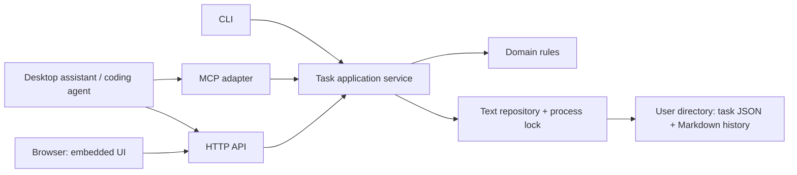

# Proposed architecture

Status: draft recommendation | 2026-10-19

## One binary, one domain service, several adapters

Use Go for a modular monolith. Initial support is macOS only. The tested target is macOS 26.7.1 arm64; older versions and Intel require execution evidence before support is advertised. Other operating systems are deferred. Compile web assets into it with [`go:embed`](https://pkg.go.dev/embed); users need no Node runtime, database server, or container. Use React and TypeScript for the UI, with Vite for development and production asset builds. This UI tooling choice was accepted on 2026-10-22; Node is required for development/builds only, not for running the packaged application.



All mutations go through the application service. Adapters translate input and errors; they do not implement their own task lifecycle or write files directly.

## Process model

Implemented entry points (global flags precede the subcommand):

```text
movement --data-dir <directory> init
movement --data-dir <directory> serve          # Loopback HTTP API and UI
movement --data-dir <directory> mcp --stdio    # Client-managed MCP subprocess
movement --data-dir <directory> task list --json
movement --data-dir <directory> task get <id> --json
```

Selected independent-process design: CLI and stdio MCP invoke the same service in their own process. A short-lived cross-process OS lock on a stable lock file serializes writes for the whole data directory. This avoids requiring a daemon for CLI or MCP use. `serve` can run alongside them. Reads acquire the same directory lock and complete recovery before reading state or history. Lists may release the lock between tasks and need not be a transaction across tasks; document that limitation.

Use stdio MCP first. Optional Streamable HTTP MCP can later share `serve`, but is not required for MVP. Follow the [MCP transport specification](https://modelcontextprotocol.io/specification/2025-11-25/basic/transports): protocol-only stdout for stdio, diagnostics on stderr; HTTP transports need origin validation and local binding protections. Client-specific configuration and transport compatibility must be verified during implementation, not assumed from this proposal.

The user selected independent processes on 2026-10-22. The [prototype](../prototypes/storage/README.md) exercises lock coordination, recovery and retries across OS processes. See [decision 004](decisions/004-independent-process-storage.md) for evidence and limits. A daemon is not required.

## UI development and packaging

Keep frontend source in `web/`, with its own package manifest, committed lockfile, TypeScript configuration, and Vite configuration. Start with React component state and hooks; add state-management dependencies only for demonstrated needs. Domain rules remain in the Go service, not duplicated in React.

During development, run the local Go API and a loopback-only Vite server. The browser requests relative `/api/v1` URLs through Vite's `/api` proxy to Go, including session bootstrap and authentication requests. Configure the backend to accept only the exact development origin/host when development mode is explicitly enabled; retain authentication and CSRF checks. Do not enable wildcard CORS or weaken packaged defaults. Proxy/session behavior must be verified with the chosen browser-auth design.

During release builds, install pinned frontend dependencies from the lockfile, run TypeScript checking separately, and build the UI into `internal/web/dist/`. Then compile Go with `internal/web/embed.go` embedding that directory. The release script regenerates assets before compilation and fails if the frontend build fails or required assets are missing; it must not silently package stale output. Ignore generated assets in version control. The packaged binary serves both UI assets and API from one local origin, requiring no Node, Vite, external asset directory, or CDN.

If client-side routes are used, Go serves the embedded entry page for UI navigation routes. API errors and missing static assets must retain their proper error responses rather than receiving the UI entry page. Verify direct navigation and refresh against the packaged binary, not only Vite. Select browser targets and pin toolchain/package versions when implementing the UI slice.

See [decision 002](decisions/002-ui-development.md). The source layout and commands are implemented at the scope recorded in [implementation status](implementation-status.md).

## Data layout

Proposed default: `~/.movement`, overridden by `--data-dir`, then `MOVEMENT_DATA_DIR`, then the default. Resolve the same explicit directory in every client configuration.

```text
<data-dir>/
  config.json
  tasks/<uuid>/
    task.json                         Current definition and state
    history/00000000000000000001-task_created.md          One immutable event per revision
  receipts/<operation-hash>.json       Durable store-wide operation responses
  transactions/staging.tmp             Unprepared journal
  transactions/prepared.json           Single pending recoverable transaction
  runtime/
    write.lock                        Stable cross-process lock file
    api-token                         Owner-readable local credential
```

Task state is JSON; history events are Markdown with YAML frontmatter. Frontmatter carries typed metadata, receipts, changes, evidence, and output references; the body carries readable notes and summaries. See the [data model](data-model.md). History is immutable through application operations; corrections append a new event. Start with directory scans and rebuildable indexes. JSON is authoritative for current state; committed history is authoritative for observations and operation receipts. This is not an event-sourced rebuild of all state.

## Mutation and recovery protocol

This split needs a recoverable transaction, not two unrelated file writes. Independent-process protocol validated in limited prototype scenarios; production hardening remains:

1. Acquire the cross-process directory lock with bounded wait. Recover pending transactions before any read or write. Validate the request and check authoritative store-wide operation receipts before revision checks so identical retries remain safe.
2. Validate revision, lifecycle, and claim; construct the complete next `task.json` and one event whose sequence and resulting revision match. Creation is revision 1. Every mutation, including a report, increments the revision once.
3. Stage exact UTF-8 bytes for task, event and receipt files (or just the receipt for repeated ingestion) plus expected prior revision and checksums in one self-contained journal on the same filesystem; target paths are derived from a validated task ID. Only one pending journal exists because writers serialize. Flush files and directory metadata. Atomically publish the prepared journal only after staging is complete and sync its parent directory. This is the recovery commitment: a prepared operation will roll forward even if its caller never receives a response.
4. Install the event without replacing an existing different event, then atomically replace `task.json` from the staged bytes and install the immutable operation receipt. Receipt-only ingestion deduplication writes no new task event. Keep staged originals until completion; flush destinations and affected directories using platform-supported durability steps.
5. After all transaction destinations are synced and verified, remove the prepared journal and sync its parent directory; clean residual unprepared staging safely. The prototype uses the journal’s presence as the recovery marker and does not need a separate committed marker. Release the lock and acknowledge the receipt. No application reader can see the intermediate pair because all readers use the lock and recovery gate.

Recovery discards unprepared staging, and idempotently rolls prepared transactions forward. Already installed bytes must match the manifest; mismatches or an unexpected state revision are corruption errors, not permission to overwrite. Interrupted cleanup after durable destination installation is harmless: a remaining prepared journal replays idempotently after destination validation. A crash before preparation leaves the old pair; after preparation, recovery produces the new pair. Retry with the same operation ID returns the persisted store-wide receipt; a different payload conflicts. Canonical input hashing, confined paths and recovery ordering are implemented and tested; see the spec and implementation status for the remaining acceptance gates.

This is logical atomicity through Movement, not simultaneous filesystem replacement of two files. External readers can see an intermediate pair during a write; copy backups with writers stopped and recovery completed. Cross-process locking, no-overwrite event installation, replacement, and durability require OS-specific validation. Network filesystems and externally synchronized live directories are unsupported initially. Corruption fails visibly without serving partial state. There are no cross-task transactions.

The guarantee covers writes through Movement. Arbitrary editor changes bypass locks, validation, and history. Offer a supported `task edit` workflow later: export a revisioned draft to an editor and import it through normal validation. Movement interfaces are the normal read/write path. Reading files, backups, and offline inspection remain possible without special tooling.

## Agent context and coordination

Return a bounded task packet with objective, description, provenance, constraints, versioned execution guidance, completion criteria, flow/delegate, versioned completion-check instructions, scheduling/follow-up fields, revision, latest reports, and history pagination. Do not automatically fetch source URLs. For actionable work, a task claim has an opaque token and expiry, preventing two cooperating agents from working the same task simultaneously. It is coordination within one local user's workspace, not a security identity boundary. Expired claims can be reclaimed with an event; reports from an obsolete claim cannot overwrite newer work. They can append attempt-linked observations through the separate observation use case; a valid current report reconciles that evidence later.

## Personal tasks and execution guidance

A personal task remains `actionable` when Claude or another assistant executes it on the user's behalf. Its versioned `execution_guidance` includes the prompt, ordered steps, input references, required capabilities, and expected output kinds. Context retrieval returns these alongside constraints and completion criteria. The assistant resolves access and inputs, claims work, performs authorized actions through its own connectors, and reports output references and evidence. Movement never launches the assistant or contacts Jira/Gmail itself.

A Gmail draft is an external side effect. Movement operation receipts only deduplicate local writes: they cannot guarantee exactly-once draft creation. Before retrying after an uncertain connector response, the assistant reconciles the external draft and records its reference, or reports uncertainty. It must not create another draft merely because its Movement report failed. See the [personal task example](../examples/personal-email.md).

## Delegation and completion checks

Keep `flow`, delegation, and check instructions in the same task record as lifecycle state. The application service supports waiting-for selection and check-report validation across every adapter. A referenced delegate does not require an account, server, or notification integration.

A check has three steps: retrieve task context with its revision and versioned check prompt; the external assistant inspects the specified source; submit a structured observation with per-criterion evidence. Retrieval and observation do not acquire an execution claim or transfer the delegated work. Recording uses the normal atomic task/history write and revision check. Stale reports conflict; the assistant rereads and reassesses. Latest-check summaries, satisfied follow-ups, and unreconciled observations are derived from history. A current check may atomically reschedule follow-up. Both work and check reports assess the same versioned authoritative criteria; only complete evidence can enter seems_completed.

Movement does not fetch URLs or execute stored prompts. Distinguish user-defined investigation instructions from fetched source text, which cannot redefine the criteria. An assistant’s inability to access a source is recorded as inconclusive, not a negative finding. A successful check enters `seems_completed` in the same transaction as its evidence event; confirmed completion remains a separate explicit operation. `follow_up_at` is queryable data for external routines, not an internal scheduler.

See the [delegated task example](../examples/waiting-for.md).

## Local security

Bind HTTP to loopback by default; no remote mode in MVP. Require a local bearer credential for API clients. Browser login exchanges that credential for a short-lived HttpOnly, SameSite session; keep tokens out of URLs and logs. Validate Host and Origin, disable permissive CORS, and protect cookie-authenticated writes against CSRF. Exact session mechanics are a design checkpoint before the HTTP slice.

Use user-private data permissions or platform equivalents. Resolve only validated task IDs beneath the configured directory; reject traversal and symlink escapes. Escape UI text and sanitize rendered Markdown; source text can contain malicious markup or instructions. Do not embed credentials from source systems in tasks. Task content is data and cannot invoke shell commands. Local administrators and processes with the user's filesystem access remain outside this protection boundary.

## Proposed source layout

Create these only as their implementation slices begin:

```text
cmd/movement/main.go             Command wiring
internal/domain/                Task types, lifecycle, selection rules
internal/app/                   Use cases, revision checks, receipts, claims
internal/store/text/            JSON/Markdown repository, locking, recovery
internal/config/                Paths, settings, timezone
internal/adapters/cli/           Human and JSON output
internal/adapters/mcp/           Tools and protocol translation
internal/adapters/http/          API, local authentication, UI serving
web/                            React/TypeScript source and Vite configuration
internal/web/embed.go            Go asset embedding
internal/web/dist/               Generated production assets, not committed
api/                            Versioned schemas and OpenAPI contract
tests/acceptance/                Cross-interface and packaged-binary checks
```

Dependency direction: adapters -> application -> domain; the text repository implements application persistence contracts. Domain code does not import transport or storage code.

## Unsupported-version guard

After acquiring the directory lock and before recovery or staging cleanup, the repository checks config and committed task/history schema versions across the store. A prepared journal is version-checked, including its nested task and event, before installation. Unsupported records fail the entire operation with `unsupported_schema`, even if the requested task is compatible or the operation has a committed receipt. This prevents an old binary from partially recovering a mixed-version store. Future fields are not decoded into current typed models before the version check. Runtime lock metadata may still be opened for coordination; authoritative record and transaction bytes remain untouched.
